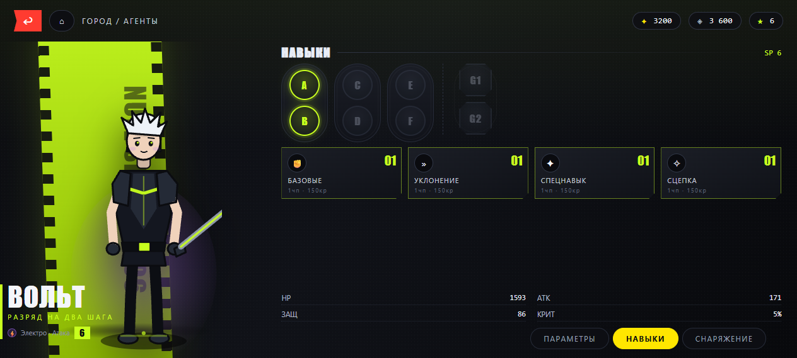

# НОЛЬ-СЕКТОР

Экшен-гача в духе **Zenless Zone Zero**: городской экшен сверху, стихийные реакции,
комбо через смену агента, крутка канала и древо навыков агента.

Чистый HTML5 Canvas + DOM, **без единой зависимости и без сборки**.
`index.html` открывается двойным кликом и работает офлайн.



---

## Как запустить

1. **Локально** — открыть `index.html` двойным кликом (Chrome/Edge/Firefox).
2. **Онлайн** — GitHub Pages: `https://hiddencars.github.io/null-sector/`

Прогресс сохраняется в `localStorage` браузера (кнопка «СОХРАНИТЬ» в меню и на станции сохранения).

---

## Управление

| Клавиша | Действие |
|---|---|
| `WASD` / стрелки | движение |
| `ЛКМ` или `J` | цепочка базовых атак (1–4 удара, финишер) |
| `E` | спецнавык агента (кулдаун) |
| `Q` | ульта (нужно 100 децибел) |
| `Пробел` или `K` | рывок (кадры неуязвимости, идеальный рывок = замедление времени) |
| `F` | цепная атака по оглушённому врагу |
| `1` `2` `3` | смена агента — **смена во время удара даёт сцепку и гарантированную реакцию** |
| `R` | взаимодействие (сундук, терминал, магазин, NPC, сохранение) |
| `Tab` | древо навыков активного агента |
| `G` / `C` / `B` / `V` / `M` | канал (гача) / агенты / магазин / заказы / карта |
| `Esc` | меню / закрыть |

---

## Системы

### Стихии и реакции (5 стихий, 10 реакций)

Наложи ауру одним элементом — добей другим. Реакция бьёт сильнее обычного удара
и даёт эффект. Урон реакции = `АТК × множитель × (1 + бонус реакций агента)`.

| Пара | Реакция | Эффект |
|---|---|---|
| Огонь + Лёд | **РАСПЛАВ** | ×2.4 мгновенного урона |
| Огонь + Электро | **ПЕРЕГРУЗКА** | взрыв по площади + отброс |
| Огонь + Эфир | **ТЛЕНИЕ** | горящая земля 5 с |
| Огонь + Физика | **ВОСПЛАМЕНЕНИЕ** | горение 6 с |
| Лёд + Электро | **СВЕРХПРОВОДИМОСТЬ** | −45 % защиты на 8 с |
| Лёд + Эфир | **КРИСТАЛЛИЗАЦИЯ** | заморозка 2.4 с (+80 % урона по цели) |
| Лёд + Физика | **РАСКОЛ** | усиленный удар по замороженным |
| Электро + Эфир | **РАЗРЯД** | молния на 3 цели |
| Электро + Физика | **ФРАКТУРА** | оглушение + шкала оглушения |
| Эфир + Физика | **КОРРОЗИЯ** | DoT + −30 % АТК цели |

### Комбо

- **Цепочка атак** — 3–4 удара, финишер отбрасывает; комбо-счётчик до ×1.6 урона.
- **Сцепка (swap)** — смена агента в окне 0.55 с после удара: удар стихией нового агента
  + децибелы + гарантированная реакция, если аура отличается.
- **Цепная атака (F)** — по врагу с заполненной шкалой оглушения: телепорт + 6 ударов
  с усиленным критом.
- **Идеальный рывок** — уклон в момент замаха врага: замедление времени и децибелы.

### Древо навыков

Шесть узлов A–F (по 3 уровня) + два ядра G1/G2 с уникальными эффектами на каждого агента
(пятый удар комбо, аура дольше, щит при входе в бой и т. д.) + четыре категории
прокачки (Базовые / Уклонение / Спецнавык / Сцепка) до 8 уровня за чипы и кредиты.

### Гача

Два канала (стандартный и событийный «ЗАТМЕНИЕ»). S-ранг 0.6 %, A-ранг 5.1 %,
мягкий гарант с 74-й крутки, жёсткий на 90-й. Дубли агентов повышают **кино-ранг**
(+1 % крита за ранг) и возвращают 40 эфиритов.

### Мир

| Район | Уровни | Особенности |
|---|---|---|
| КАЙРОС | — | хаб: терминал, магазин, доска заказов, NPC |
| РЖАВЫЙ ПОЯС | 3–8 | свалка техники, физика/электро |
| ГОЛОДНАЯ ПЕЧЬ | 9–15 | лава, босс **ГОЛЕМ-ПЕЧЬ** |
| КРИОБУХТА | 16–22 | лёд, босс **МАТЬ-ИНЕЙ** |
| РАЗЛОМ НОЛЬ | 23–30 | пустота, финальный босс **НОЛЬ** |

Сундуки, точки быстрого перемещения, заказы, погода по району, мини-карта.

---

## Структура проекта

```
index.html          — собранный автономный билд (это и есть игра)
build.py            — собирает index.html из src/
src/
  index.html        — dev-версия (подключает файлы ниже)
  style.css         — весь визуальный слой в стиле ZZZ
  data.js           — ВСЁ содержимое: стихии, реакции, агенты, враги, районы, гача
  engine.js         — утилиты, ввод, камера, частицы, синтезированный звук, сохранение
  art.js            — процедурная SVG-графика агентов + отрисовка бойцов на канвасе
  world.js          — генерация карты, районы, реквизит, коллизии, погода, миникарта
  combat.js         — боевая система: цепочки, реакции, смена, ульты, ИИ врагов
  ui.js             — HUD, древо навыков, гача, коллекция, магазин, диалоги
  main.js           — состояние игры, главный цикл, взаимодействия, рендер
shots/              — скриншоты
```

### Как править контент

Почти всё лежит в `src/data.js`:

- **новый агент** — добавить объект в `CHARS` (палитра `art`, цепочка `basic.hits`,
  `skill`, `ult`, `tree`); SVG-фигура и портрет соберутся сами;
- **новая реакция** — строка в `REACTIONS` с ключом `'элемент|элемент'` (по алфавиту);
- **баланс врагов** — `ENEMIES` (hp/atk/def/spd/ai/atkType);
- **районы** — `REGIONS` (прямоугольник, уровни, погода, пул врагов);
- **цены и шансы** — `GACHA` и `SHOP`.

После правок:

```bash
python build.py     # пересобирает index.html
```

---

## Технические детали

- Canvas с учётом `devicePixelRatio` (не мылит на ноутбуках).
- Звук синтезируется через WebAudio (осцилляторы + шум), без аудиофайлов.
- Карта генерируется детерминированно (mulberry32, seed 1337) — одинаковая при каждом запуске.
- Отрисовка мира с y-сортировкой, псевдо-объём зданий, AO у стен, погодные частицы.
- Тестовый хук в консоли: `window.__game.state()`, `.give(1000)`, `.spawn('golem')`, `.tp(48,17)`.
